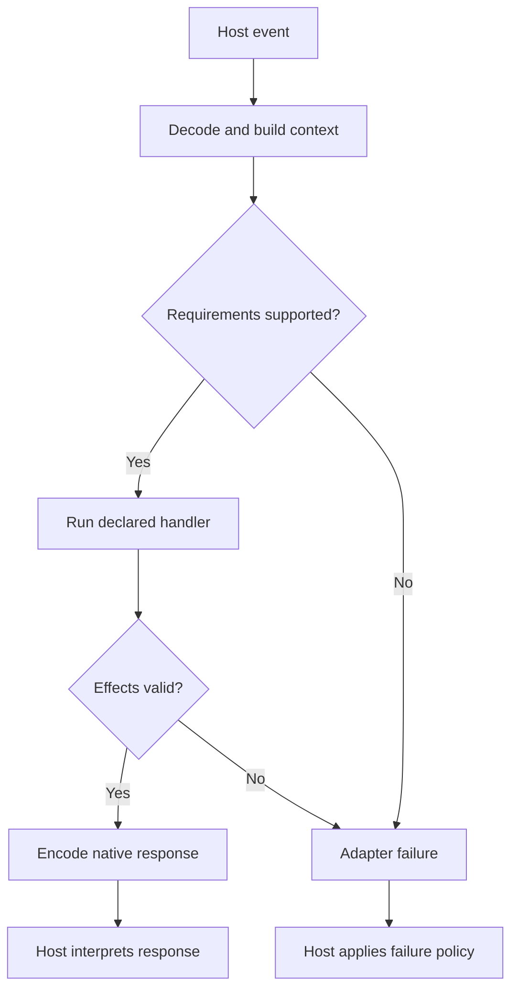

# @getty/bun-runtime — Engineering Handoff and Build Plan

**Status:** proposed architecture and implementation instructions; no package or provider implementation is claimed.  
**Research checkpoint:** 2026-11-25, Europe/Berlin.  
**Audience:** engineers and coding agents implementing a reusable Bun package for Claude Code, Codex, and Hermes plugins.  
**Deliverable:** one self-contained specification, dependency assessment, normalization plan, and staged acceptance plan.  
**Working package name:** `@getty/bun-runtime`; npm name availability and publishing rights must be verified before publication.

## Reading map

- **Sections 1–3:** decisions, naming, and the existing runtime-provider contract.
- **Sections 4–5:** ready scripts, public APIs, configuration, and exact-runtime invocation.
- **Sections 6–7:** hook normalization and common service contracts.
- **Sections 8–10:** implementation work packages, acceptance tests, and handoff requirements.
- **Appendix A:** sourced host semantics and normalization hazards.
- **Appendix B:** package layout, executable packaging, existing SDKs, and release proof.
- **Appendix C:** npm selection matrix with release/license observations and adoption decisions.
- **Appendix D:** targeted prior art for hook helpers and emerging portable hooks, when available.

The proposed API and command names in Sections 4–7 are canonical for this handoff. Research findings inform those contracts; they do not introduce a second naming scheme.

## 1. Decisions to carry into implementation

Build an ordinary, versioned npm package that provides **both imported APIs and ready-to-run commands**. A plugin should be able to declare one dependency, configure a ready handler, and use it without writing a new program for every hook. Plugins with custom behavior should import the same underlying functions.

Keep one real `package.json` and shipped `bun.lock` per independently distributed plugin. All of that plugin's scripts share its dependency graph. The SDK's release number and the selected Bun executable version are independent.

Preserve the existing **Getty Bun integration contract proposal v0.1**. Its `getty-bun` provider provisions Bun; this new npm package provides plugin support code after Bun and dependencies are available. They may share a repository later, but they have different bootstrap requirements and public contracts.

Normalize transport, context, configuration, process results, and explicitly defined effects. Preserve host-native event names and source payloads. A familiar word such as `approve`, `stop`, or `block` does not establish a shared effect.

Start with a small package and a public dispatcher. Reuse existing libraries where they solve an actual requirement; use Bun's built-ins where they already cover the primitive. Introduce an optional MCP companion package when an MCP feature is implemented, so the base package need not pull in an entire protocol SDK.

### Evidence vocabulary

| Label | Meaning in this document |
| --- | --- |
| **Existing Getty decision** | A constraint carried from the supplied `getty-bun-integration` skill; a proposal, not a claim that software is installed. |
| **Source-verified** | Observed in linked official documentation or source at the research checkpoint. |
| **Proposed** | An API, package layout, default, rule, or implementation decision recommended here. |
| **To verify** | A concrete acceptance test or release inspection still required. |

No npm installation, host end-to-end test, production deployment, or package publication was performed for this report. Source availability and a plausible API are not runtime compatibility evidence.

## 2. What the name means

`@getty/bun-runtime` is a reasonable name for a Bun-based support runtime used by plugins. Its README should define it immediately:

> Shared APIs and executable helpers for Getty plugins running under a managed Bun runtime.

Use these names consistently:

| Name | Responsibility |
| --- | --- |
| `getty-bun` | Existing proposed provider of exact, verified Bun executable installations. Do not invent a CLI with this name unless implementing it. |
| `bun` / `bun.exe` | The executable inside a managed runtime slot. |
| `@getty/bun-runtime` | The npm package specified here: core APIs, host codecs, dispatcher, ready commands, schemas, and fixtures. |
| `getty-bun-runtime` | Proposed optional `bin` command for developer convenience. Host execution uses an explicitly selected executable and entry file. |
| Consumer plugin | Its own behavior, supported host combinations, dependency pins, configuration, and host registrations. |

This scope is sufficient to supply a runtime library without claiming to replace Bun, an agent host, or that host's own SDK.

## 3. Preserve the existing Getty contract

The following constraints are carried from the existing skill and its `contract.md`, `dependencies-and-execution.md`, `installation-locking.md`, and `paths-platforms.md`. They are restated so the implementer does not need access to those files.

1. The consumer's real `package.json` contains `gettyBun.contractVersion` and one exact `gettyBun.bunVersion`. These are Getty fields; Bun does not enforce them.
2. Contract v0.1 accepts a stable `major.minor.patch` Bun version. Ranges, tags, and inferred versions are not valid runtime requirements.
3. One user and execution environment may share one verified Bun installation per exact version and release target. Windows, a WSL distribution, a container, and a remote host are separate execution environments.
4. Runtime slots are immutable during ordinary execution. A new version is installed alongside the previous one, then selected consumers are rebound.
5. Execution uses the validated **absolute Bun executable**. PATH, a mutable `current` symlink, `bun upgrade`, and a shebang are not version-selection mechanisms.
6. Bootstrap must work before external Bun or Node is installed. Code from this npm package cannot perform that first step.
7. Dependencies are explicitly prepared from the consumer manifest and shipped lockfile. Ordinary execution uses `--no-install`.
8. The shared runtime-slot lock does not also coordinate a consumer dependency tree. Those are different mutations.
9. `.installing` is diagnostic metadata: PID, process name, process start identity when available, attempt identity, and environment. It does not confer lock ownership.
10. Installation mutations require the established OS-backed mutex protocol. A directory-lock npm module is not an interchangeable implementation.
11. Bindings include consumer/package identity, manifest and lockfile digests, runtime key, absolute executable, and readiness results. Package moves and changed dependency graphs invalidate the relevant binding.
12. Setup output and application protocol output remain separate.

**Lockfile trap:** Bun documents that `--frozen-lockfile` can install from `package.json` if there is no lockfile, and can use another lockfile by migrating it in memory. Therefore, first verify that the expected `bun.lock` actually exists; the successful command alone is insufficient evidence. [Bun install](https://bun.com/docs/pm/cli/install)

### Consumer manifest sketch

The package and version below are proposed example values, not published releases or compatibility promises. The Bun pin must be the exact version tested by that consumer.

```json
{
  "name": "example-getty-plugin",
  "version": "0.1.0",
  "private": true,
  "type": "module",
  "gettyBun": {
    "contractVersion": 1,
    "bunVersion": "1.4.5"
  },
  "dependencies": {
    "@getty/bun-runtime": "0.1.0"
  }
}
```

Keep package version policy explicit. An exact direct dependency makes consumer updates deliberate; `bun.lock` fixes the installed graph. Do not publish one universal mutable library instance and silently switch all consumers to it.

## 4. Deliver three ways to use the same implementation

### 4.1 Imported API

For a custom script, expose small, typed functions with explicit context. A utility import must not install packages, create background services, register hooks, scan every host's home directory, or write state.

Proposed public entry points:

| Import | Purpose |
| --- | --- |
| `@getty/bun-runtime` | Core types and deliberately small convenience exports. |
| `@getty/bun-runtime/context` | Construct plugin and invocation context from explicit inputs. |
| `@getty/bun-runtime/config` | Read and validate declared configuration. |
| `@getty/bun-runtime/process` | Managed subprocess results, deadlines, and cancellation. |
| `@getty/bun-runtime/state` | Namespaced storage interfaces and explicit backend semantics. |
| `@getty/bun-runtime/claude` | Claude command-hook decoding, capability validation, and encoding. |
| `@getty/bun-runtime/codex` | Codex command-hook decoding, capability validation, and encoding. |
| `@getty/bun-runtime/hermes` | Hermes shell-hook decoding, capability validation, and encoding. |
| `@getty/bun-runtime/cli` | Public dispatcher entry, usable by direct execution or an optional launcher. |
| `@getty/bun-runtime/testing` | Fixtures and contract assertions; no host-compatibility claim from mocks. |

Add exports only when implemented. A design table is not an instruction to publish empty modules.

### 4.2 Ready commands, directly owned by the package

The CLI dispatches to the same functions as the imported APIs. It should not duplicate business logic.

| Proposed command | Concrete behavior | Initial scope |
| --- | --- | --- |
| `doctor` | Once the CLI can load, report the runtime binding, selected adapters, and missing capability evidence. Provider/setup preflight detects a missing SDK or entry before this command exists. | Required; read-only by default. |
| `config inspect` | Show validated effective non-secret settings and their source layers. | Required. |
| `hook dispatch` | Decode a host invocation, run a declared ready/custom handler, compile effects, and emit exactly one host result. | Required. |
| `hook explain` | Statically decode a supplied fixture, inspect registration/capabilities, and optionally compile an explicit effects fixture. It does not import or execute arbitrary custom handlers. | Required developer aid. |
| `context emit` | Produce bounded context from a declared file for a supported host event. | Required ready handler. |
| `hook record` | Capture an explicitly requested, redacted test fixture with provenance. | Optional development command; never implicitly archive full user inputs. |
| `state inspect` | Inspect plugin-owned state with explicit scope and schema. | Add when the state backend is implemented. |
| `mcp serve` | Serve a declared tool/resource set through the MCP companion. | Later phase. |
| `build host-config` | Render host-specific registration fragments from validated configuration. | Add after launch encoding is verified for each target. |

There is no `install` side effect hidden in `doctor`, an import, or a hook. Actual provisioning remains an explicit setup activity.

Prefer a single dispatcher plus reusable handlers. A package can ship multiple entry files later if startup measurements justify them. Do not create one public executable for every internal helper without a demonstrated need.

For ordinary CLI commands, define exit codes separately from hook protocols: propose `0` for success, `1` for an operational failure, and `64` for invalid CLI usage. Hook adapters own their event-specific exit mapping; a generic parser/catch block must not emit exit `2` merely because it is a convenient error code. MCP request failures use the selected SDK's protocol response, with process exit reserved for lifecycle failures.

Define the public dispatcher contract as `main(options): Promise<number>`. It completes required response flushing and cleanup, then returns the process status. Direct execution and a consumer-owned launcher both assign `process.exitCode = await main(...)`. Importing the module never exits the caller or changes its exit status. Hook response codecs determine the returned hook status.

### 4.3 Declarative use for a plugin with no custom hook script

A plugin can depend on the package and declare a ready handler in `getty-runtime.json`. This is a proposed schema; implement and ship its JSON Schema alongside the runtime.

```json
{
  "schemaVersion": 1,
  "pluginId": "example-getty-plugin",
  "handlers": {
    "project-hints": {
      "kind": "context.from-file",
      "root": "consumer",
      "path": "resources/project-hints.md",
      "maxBytes": 8192
    }
  },
  "bindings": [
    {
      "host": "claude-code",
      "event": "SessionStart",
      "handler": "project-hints"
    },
    {
      "host": "codex",
      "event": "SessionStart",
      "handler": "project-hints"
    },
    {
      "host": "hermes",
      "surface": "shell-hook",
      "event": "pre_llm_call",
      "handler": "project-hints"
    }
  ]
}
```

The two session-start bindings and the Hermes before-turn-loop binding have different timing and repetition. The Hermes example repeats for eligible user turns; it does not imply a callback before every provider request or the session-start frequency of the other bindings. A once-per-session variant needs a separate deduplication policy grounded in actual lifecycle identity. [H4]

The example's 8192-byte cap is a proposed input-file budget, not a host context limit or a token count. The host adapter also checks its output budget.

The implementation must resolve `root: "consumer"` against the installed consumer package. `root: "project"` is a separate, explicit choice. It must reject a relative file that escapes the declared root after resolution when confinement was requested.

For custom code, the consumer can declare a module path and export name in its own trusted package. Do not treat a path or function name from untrusted hook input as an instruction to import arbitrary code.

Every registered custom handler also declares `requires`: its effects, delivery requirements, foreground/background constraints, and required identity fields. Ready handlers provide this declaration as package metadata. Setup validates the declaration, and the dispatcher checks it again against the actual invocation before importing or executing the handler. An effects fixture can be inspected statically; executing a custom handler is a separate test/replay operation with explicit isolation, not a pretend sandbox supplied by a `dryRun` boolean.

## 5. Canonical launch and dependency resolution

### 5.1 Machine binding

Extend the existing consumer binding with the resolved runtime-package entry and its identity. Proposed shape:

```ts
interface ConsumerExecutionBinding {
  schemaVersion: 1;
  consumerRoot: string;
  consumerContentId: string;
  manifestDigest: string;
  lockfileDigest: string;
  bun: {
    version: string;
    target: string;
    executable: string;
    receiptIdentity: string;
  };
  supportRuntime: {
    packageName: "@getty/bun-runtime";
    packageVersion: string;
    cliEntry: string;
    packageIdentity: string;
  };
}
```

All paths in this machine-local record are absolute. Do not commit the record into a portable plugin release.

The setup sequence is:

1. Validate the consumer requirement and select/provision the exact Bun runtime through the provider.
2. Confirm that the intended consumer `bun.lock` was shipped.
3. Stage consumer dependencies under consumer-specific coordination.
4. Use the selected Bun executable for frozen installation according to the established script policy.
5. Resolve the public package entry **from the consumer package**, not from the user's working project.
6. Verify the installed package identity and run a no-network smoke invocation.
7. Publish the immutable prepared consumer and its binding.
8. Generate host launch registrations using the actual target shell/process contract.

The packaging research below supplies source-verified resolver and export details.

### 5.2 Runtime invocation

Canonical invocation model, expressed as data rather than platform-specific shell syntax:

```ts
const launch = {
  executable: binding.bun.executable,
  args: [
    "--no-install",
    binding.supportRuntime.cliEntry,
    "hook",
    "dispatch",
    "--consumer",
    binding.consumerRoot,
    "--host",
    "claude-code",
    "--event",
    "SessionStart",
    "--handler",
    "project-hints"
  ],
  cwd: binding.consumerRoot
};
```

The CLI must accept the user's project directory separately, normally from a validated host payload or an explicit application argument. It must not change dependency ownership by changing `cwd` to the target project.

If the host only accepts one command string, the installer needs a renderer for that specific host and shell. POSIX quoting, PowerShell quoting, Windows process argument encoding, and Hermes command parsing are separate paths. Do not use a universal string concatenator.

A consumer-owned minimal launcher is a legitimate alternative when a host's cache relocation makes persistent entry paths awkward. It should import the stable public CLI export. It is one shared launcher for the plugin, not a wrapper copied for every ready action.

### 5.3 Refresh and failure

Re-resolve the package entry when the consumer root, locked package version, or relevant package content changes. Never silently fall back to a globally installed copy.

A missing entry or import produces a setup/readiness error. Running hooks do not call `bunx`, fetch npm packages, edit lockfiles, or repair their environment. The setup mechanism receives an actionable diagnosis.

## 6. Normalize a protocol, not just field names

### 6.1 Stable envelope

Keep normalized facts small and represent missing data as missing. A proposed envelope:

```ts
interface HookInvocation {
  contractVersion: 1;
  invocationId: string;
  host: {
    kind: "claude-code" | "codex" | "hermes";
    surface: "command-hook" | "shell-hook";
    version?: string;
    adapterRevision: string;
  };
  plugin: {
    id: string;
    version: string;
    root: string;
  };
  event: {
    nativeName: string;
    family?: "session" | "prompt" | "tool" | "model" | "completion";
    executionMode: "foreground" | "background";
  };
  location: {
    processCwd: string;
    hostWorkingDirectory?: string;
    targetProjectRoot?: string;
    dataRoot: string;
    cacheRoot: string;
  };
  identity: {
    hostSessionId?: string;
    hostParentSessionId?: string;
    hostTurnId?: string;
    hostToolCallId?: string;
    profileId?: string;
  };
  tool?: {
    nativeName: string;
    input: unknown;
  };
  native: {
    input: Readonly<Record<string, unknown>>;
  };
}
```

The generated `invocationId` is a Getty execution identifier. It must not be passed off as the host's tool-call identity or an idempotency key for repeated host delivery.

`family` supports routing and display. It does not promise matching timing, authority, or return semantics across hosts. Preserve native names when the relationship is ambiguous.

`processCwd` describes our process, which normally starts in the consumer root. `hostWorkingDirectory` comes from a validated host payload when available. Record the origin of derived paths. Do not fill a missing host directory with the consumer root and call that host context. Do not automatically classify a working directory as a repository root. Do not make a missing profile equal to a global singleton. Do not assume host tool names are identical because their purposes look similar.

### 6.2 Effects with explicit meaning

The initial effect vocabulary should be smaller than all host features:

```ts
type ContextPlacement =
  | "session-start-input"
  | "current-turn-next-model-request"
  | "future-turn"
  | "subagent-input";

type PermissionIntent = "preserve-host-policy" | "request-human-approval" | "grant";

type HookEffect =
  | { kind: "no-decision" }
  | {
      kind: "add-context";
      text: string;
      audience: "model";
      placement: ContextPlacement;
    }
  | { kind: "deny-pending-tool"; reason: string }
  | { kind: "request-human-approval"; reason: string; ruleKey?: string }
  | {
      kind: "replace-tool-input";
      input: unknown;
      permissionIntent: PermissionIntent;
    }
  | {
      kind: "merge-tool-input";
      patch: Record<string, unknown>;
      permissionIntent: PermissionIntent;
    }
  | { kind: "replace-completed-tool-result"; result: unknown }
  | { kind: "request-more-work"; reason: string };
```

This is an API proposal, not a claim that every listed effect is supported on every host. In particular:

- `no-decision` preserves normal host processing. It does not grant permission.
- `deny-pending-tool` is meaningful only before the pending operation executes.
- `request-human-approval` must reach an actual approval mechanism. Printing a question into model context is not an implementation.
- Replacement and shallow merge are separate effects. A host that merges a partial argument object cannot automatically implement full replacement or property deletion.
- Rewriting and authorization may be coupled. The adapter must reject a request to preserve host policy when the only verified native rewrite path grants permission. `permissionIntent` is mandatory; no implicit conversion from preserve to grant is allowed.
- Replacing a completed result does not undo completed side effects.
- Requesting more work means continuation at the selected completion gate. Whether that creates a new turn, a continuation prompt, or verification-loop work belongs to the host capability record.
- Context placement and repetition are part of the requested effect. The adapter must not substitute a later user turn for context required in the active turn.
- The public vocabulary should avoid an ambiguous operation named `approve`.

Defer an `allow-pending-tool` effect until a real plugin needs to grant permission and its interaction with host policy has been explicitly reviewed. Most plugins only need no-decision, context, denial, or a request for human approval.

### 6.3 Capability records

Key support by all relevant dimensions:

```ts
interface CapabilityKey {
  host: HookInvocation["host"]["kind"];
  surface: HookInvocation["host"]["surface"];
  hostVersion: string;
  nativeEvent: string;
  executionMode: "foreground" | "background";
  adapterRevision: string;
  policyProfileId: string;
  relevantConfigurationDigest: string;
}
```

A record should include:

- Supported effects and permitted combinations.
- Input schema identifier and output codec.
- Context delivery point and audience.
- Error/timeout behavior actually controlled by the host.
- Config flags or host review required to enable that behavior.
- Evidence URL, checked source revision, and observed host test version.
- Status: unknown, documented, source-inspected, fixture-verified, runtime-tested, or unsupported.

Do not invent a minimum host version from a moving documentation page. A known version without an exact record may match an evidenced compatibility range. A missing or unverifiable host version cannot establish range membership. Reject control-capability bindings in that case unless a separately specified capability probe establishes the necessary contract.

### 6.4 Compile before emitting

Use a single response owner:

1. Read bounded input.
2. Decode the selected host event.
3. Construct explicit context.
4. Preflight the handler's declared requirements against this invocation before importing/executing custom code.
5. Execute the declared handler.
6. Validate every requested effect and its combination.
7. Encode the host-specific output and exit behavior.
8. Write the protocol response once.
9. Finish with the selected exit code.

Unsupported effects are explicit errors. The runtime must not quietly convert unsupported approval requests to allow, convert full replacement to merge, or claim a denied action was blocked when the host continued.

A runtime error itself does not guarantee prevention. For a plugin that requires a blocking gate, setup must verify the host's blocking behavior and configuration. If that requirement cannot be met, installation should report the incompatible integration instead of advertising enforcement.



The two final paths are deliberately different: producing a valid control response and suffering an adapter failure can have different host consequences.

### 6.5 Composition inside one Getty handler

Start with deterministic ordered steps declared by the consumer. Distinguish composition inside our handler from how the host combines independently installed hooks.

Proposed v1 rules:

- Accumulate context contributions in declared order, with an explicit combined budget.
- Allow at most one argument-writing step until composition semantics are tested.
- Treat denial as terminal for subsequent behavior in our pipeline.
- Reject mutually incompatible effects before output.
- Preserve errors and partial work; do not label skipped steps successful.
- Do not expose parallel rewriting or implicit retries in v1.
- Preserve raw host fields for diagnosis and intentional native adapters, but require a single output owner. A native response escape hatch is an explicitly selected mode, not something merged blindly with normalized effects.

## 7. Core service contracts

### 7.1 Context and paths

Resolve four separate roots: provider runtime, installed consumer code, target project, and writable plugin data. Cache is a fifth lifecycle when used.

Prefer a host-provided profile-aware data directory. Use an OS-directory helper only as a documented fallback. Namespaces must include plugin identity; project-scoped state also needs an explicit project identity. A human-readable directory name is not necessarily a collision-free key.

Pass context into functions. Avoid hidden global "current plugin" state so tests and future long-lived servers can host more than one context safely.

A hook is usually a new process. Module variables cannot provide cross-invocation persistence. A long-lived MCP server has a different lifetime and must not reuse a stale invocation context.

### 7.2 Configuration

Use data-only configuration by default. Proposed precedence, from lowest to highest:

1. Package-provided defaults.
2. Explicit host/user configuration for this plugin and profile.
3. Explicitly enabled project configuration.
4. Documented environment overrides.
5. Explicit CLI arguments.

The consumer may select a narrower set; record the actual precedence. Retain provenance for effective fields so `config inspect` can explain a setting.

Do not discover arbitrary parent-directory configuration, evaluate repository JavaScript/TypeScript, expand remote Git configuration, or start watchers as an incidental import. A plugin can opt into an executable configuration module as trusted application code, but it is a separate mode with a clear lifecycle.

Validate known fields and give path-specific errors. Keep credentials as host/provider references where possible. Diagnostics should report that a credential source is configured, not print its value.

### 7.3 Processes

Expose argument-array execution with explicit `cwd`, environment policy, deadlines, cancellation, output limits, and an observable result:

```ts
interface ProcessResult {
  exitCode: number | null;
  signal: string | null;
  timedOut: boolean;
  cancelled: boolean;
  stdout: Uint8Array;
  stderr: Uint8Array;
  stdoutTruncated: boolean;
  stderrTruncated: boolean;
}
```

A convenience checked variant may throw on failure, but retain the complete result. Do not discard a nonzero code or return a success-shaped empty value.

Use the bound Bun executable for Bun children. For other executables, the caller must select a command or an explicit executable policy. Avoid implying that every process in the application must be Bun.

Ordinary direct subprocess execution does not require a shell. If shell syntax is needed, make the shell and its grammar explicit. Process-tree cleanup, inherited handles, signal behavior, and Windows job semantics require platform-specific evidence; do not promise tree termination merely because one process was killed.

### 7.4 State

Provide namespaced state paths and backend-specific guarantees:

| Backend | Appropriate initial use | Promise to expose |
| --- | --- | --- |
| Atomic JSON snapshot | Small configuration-like snapshots with one writer or deliberate last-writer-wins semantics. | Complete-file replacement, schema validation, explicit write policy. |
| SQLite | Shared counters, cursors, deduplication records, or multi-process state that needs transactions. | Transactions and concurrency behavior validated on the chosen Bun/OS/filesystem. |
| Host-owned state | A host already provides suitable state APIs within a native adapter. | Host-defined scope and lifecycle; access through its supported API. |

Atomic replacement prevents partial-file publication. It does not alone prevent two processes from reading the same old state and losing an update. An in-process write queue does not coordinate independent hook processes.

Do not give all backends an apparent `transaction()` that only some can implement. Keep schema migrations explicit and versioned. Updating library code must not silently perform irreversible data migrations while a normal hook is running.

### 7.5 Logging and errors

Reserve stdout for the selected protocol. A normal CLI command may choose human-readable stdout; a hook/MCP command may not mix progress lines with its structured response.

Use structured errors with fields such as `code`, `message`, `stage`, `pluginId`, `host`, and `retryable`, plus a bounded diagnostic cause. Useful initial codes include:

- `RUNTIME_BINDING_INVALID`
- `DEPENDENCIES_NOT_READY`
- `HOST_VERSION_UNVERIFIED`
- `HOOK_INPUT_INVALID`
- `HOOK_EFFECT_UNSUPPORTED`
- `HOOK_EFFECT_CONFLICT`
- `CONFIG_INVALID`
- `PROCESS_FAILED`
- `PROCESS_TIMEOUT`
- `STATE_CONFLICT`

These names are proposed. They describe runtime outcomes and must not imply host enforcement that did not happen.

### 7.6 Lifecycle and cancellation

Each execution owns a deadline and cancellation signal. Configuration and validation happen before launching expensive work. Stop accepting new steps when cancelled. Await required output flush and bounded cleanup.

Keep network access, retries, and detached work explicit in the consumer's behavior. The support runtime should not make a failed hook start a new agent, ask a remote LLM to repair itself, or create a background daemon.

### 7.7 MCP support

MCP offers a useful shared boundary for tools, resources, and prompts. It does not make lifecycle hooks, host approval semantics, or UI contributions identical.

Build the MCP adapter on the official SDK line selected by current research. Let the SDK own protocol framing, transport details, request cancellation, and negotiated capabilities where available. Our wrapper should supply plugin context, schema validation, common errors, and consistent business-handler interfaces.

Use `@getty/bun-runtime-mcp` as the proposed companion name. A consumer opting into MCP declares it explicitly. During setup, resolve its public `@getty/bun-runtime-mcp/cli` entry from the validated consumer root and record its absolute path, package identity, and adapter-contract version in that consumer's binding. The base `mcp serve` dispatcher loads this verified entry; it must not assume that a bare sibling import from inside the base package is visible under every install layout. Missing or incompatible companions produce a readiness error, with no automatic install. The companion exports the same `main(): Promise<number>` lifecycle contract for forwarding.

Bind the proof to the selected protocol revision. The current 2026-07-28 transport contract carries protocol and client capability metadata on requests; do not carry older initialization-handshake assumptions into a v2 implementation without checking the actual SDK path. [M3]

Keep tool annotations and human approval separate. A tool's declaration is not evidence that the host authorized its action. Tool handlers should preserve actual failures and return the appropriate protocol result.

## 8. Implementation work packages and exit gates

The phases below describe an order of construction, not estimated calendar dates.

| Phase | Build | Required evidence before moving on |
| --- | --- | --- |
| **0 — Freeze the boundary** | Confirm package name access, supported Bun pin(s), target OSes, initial host builds, naming, and the provider interface actually available. Record a small ADR set. | No invented provider commands or host versions; documented source and test target matrix. |
| **1 — Package and core** | ESM package, public exports, CLI dispatcher, context, input/output, minimal config, typed errors, and process result model. | Import has no unintended side effects; packed consumer can import and run it with the selected Bun. |
| **2 — Ready handlers** | `doctor`, `config inspect`, `context.from-file`, `hook dispatch`, and fixture-based explanation. | A consumer with only manifest, runtime config, and a context file performs useful work without custom hook code. |
| **3 — Claude and Codex adapters** | Separate codecs, supported effect tables, launch renderers, and host-specific registration examples. | One real installed end-to-end path on each claimed build; distinct output semantics tested. |
| **4 — Hermes shell adapter** | Direct Bun subprocess route, profile/context mapping, approval/modify semantics, and Windows command encoding. | Real shell-hook invocation and observed host effect. Add a Python bridge only for a feature that needs a native API. |
| **5 — State and MCP features** | Implement the selected state backend for a real consumer; add the optional MCP package and a small real server. | Multi-process state behavior and host-to-server tool call verified where claimed. |
| **6 — Release and upgrade** | Pack inspection, clean consumer install, old/new version coexistence, documentation, examples, and provider-binding refresh. | Release acceptance matrix passes; old consumers retain their selected runtime and package. |

Phases 0–4 form the first useful SDK release. Phase 5 features may be released independently when the plugin driving them is ready. Do not hold the basic dispatcher hostage to a comprehensive abstraction of every host feature.

### Suggested source ownership

| Proposed path | Responsibility |
| --- | --- |
| `src/cli.ts` | Export `main()` and guard direct execution. Keep generic CLI exit handling away from host serializers. |
| `src/core/` | Context, configuration, error, process, and state contracts. |
| `src/hosts/claude/`, `src/hosts/codex/`, `src/hosts/hermes/` | Native decoders, capability records, output encoders, and configuration renderers. |
| `src/ready/context-from-file.ts` | Ready action metadata, declared requirements, and bounded file-context behavior. |
| `schemas/` | Versioned Getty configuration and recorded host-schema references. |
| `fixtures/public/` | Curated, redacted inputs, expected semantic effects, native outputs, and provenance records that the public testing API may load. Include this directory in the packed artifact. Keep local captures outside this publication allowlist. |
| `examples/ready-context/` | Minimal consumer with no custom hook script. |
| `examples/custom-handler/` | One consumer using the imported API. |
| `tests/host-e2e/` | Host-driven acceptance scenarios with actual side-effect observations. |
| `scripts/build.ts` | Producer build and packed-artifact preparation. |
| `docs/compatibility.md` | Exact documented/tested host, runtime, and platform combinations. |

Use the same schemas and serializers in imported and ready-command paths. Avoid separate implementations that merely happen to produce similar JSON.

### Suggested ADRs

1. Per-consumer dependency graph and independent Bun/SDK versioning.
2. Absolute-executable launch contract and package entry resolution.
3. Semantic effects and host/event capability records.
4. Configuration trust and precedence.
5. State backends and concurrency guarantees.
6. Optional MCP package and SDK release line.
7. Host registration generation and evidence policy.

## 9. Acceptance tests that matter

These are implementation instructions, not tests reported as executed.

| Scenario | Observable assertion |
| --- | --- |
| SDK version differs between two plugins | Each imports and executes its declared version without rebinding the other. |
| Bun version differs between two plugins | Each starts the bound executable; shared same-version consumers still reuse the provider slot. |
| No `bun.lock` in a release | Setup rejects the release before installation; frozen-install success is not used to waive this. |
| Dependency missing during a hook | No network fetch occurs; the error identifies the setup problem. |
| Working directory is an unrelated repository | Consumer imports remain tied to consumer dependencies; target-project operations use the explicitly selected project. |
| Consumer cache moved | Old entry binding is rejected or refreshed; no global SDK fallback. |
| Windows path has spaces, Unicode, and backslashes | The real host launches the selected executable with intact arguments. |
| Package bin has an unsuitable shebang | Canonical host invocation still uses the explicit Bun executable. |
| Invalid input JSON or wrong event type | Bounded diagnostic, one controlled response path, no accidental success claim. |
| Unknown input extension fields | Preserved where allowed; not automatically forwarded as output directives. |
| Claude legacy `approve` versus Hermes `approve` | Both decode to their actual distinct meanings; token copying is impossible. |
| Codex event cannot request human approval | The compiler reports unsupported capability; it never emits an unsupported `ask` and calls that enforcement. |
| Input rewrite requests preservation of host policy | An adapter whose verified rewrite path requires granting permission rejects the mismatch before handler side effects. |
| Full replacement requested on a merge-only path | Explicit rejection or a separately verified implementation; no silent partial merge. |
| Attempt to deny an already completed operation | Rejected as an invalid effect for that event. |
| Background invocation requests synchronous control | Rejected unless the exact host contract supports that effect. |
| Two handlers request incompatible rewrites | Deterministic conflict before response output. |
| Diagnostic output from a child | Captured or redirected; protocol stdout remains parseable. |
| Handler crashes or times out | Observed real host behavior matches the adapter's documented limitation/configuration. |
| Two processes update shared state | Backend-specific contract holds; tests detect lost updates where transactions are promised. |
| State file interrupted during replacement | No partial published file; recovery behavior matches the chosen writer and filesystem. |
| MCP server startup | Only protocol traffic on stdout; client completes the setup required by the selected protocol/transport and a real tool call. |
| SDK import used in a test | No installation, auto-registration, or unrelated filesystem writes. |
| Update of one consumer | Other consumers keep old package/runtime bindings and working state. |
| Rollback of code | State compatibility is checked; no blind downgrade across incompatible schema migrations. |
| npm tarball inspection | All exported files and notices exist; source maps, declarations, schemas, and ready handlers resolve as documented. |

Use native Bun tests for pure code and actual host invocations for host claims. A mocked `stdin`/`stdout` test proves our serializer, not the agent's interpretation of it.

### Performance evidence

Measure cold process startup separately from handler work, package import, config loading, and host overhead. Use a no-op, a short context file, and a subprocess command as separate workloads.

Record Bun version, host build, OS/CPU/filesystem, input sizes, warm/cold state, sample count, and p50/p95. Do not set a marketing latency claim before measurement. Introduce an explicit agreed budget after the first working baseline.

If broad root imports cost time, measure narrower imports or separate CLI entry modules. A permanently running service is a later architectural choice with additional lifecycle cost.

## 10. Release, maintenance, and the implementation handoff

### Deliverables expected from the implementer

- The package source and public API declarations.
- A real `package.json`, lockfile, export map, and file allowlist.
- Ready CLI commands and at least one zero-custom-script consumer example.
- Independent Claude, Codex, and Hermes shell adapter examples.
- Versioned configuration and effect schemas.
- A compatibility record separating documentation evidence from actual runtime tests.
- Tests for the semantic differences highlighted in this document.
- Package/license inventory and dependency review for the exact selected release.
- Setup/binding integration with the existing provider contract.
- Upgrade and rollback documentation, including state-schema limits.
- A short API usage skill and examples aligned with the released package.

Keep the package's usage skill separate from installer implementation details. Update `getty-bun-integration` with the actual dependency and binding contract only after that contract is implemented and exercised. This report does not modify installed skills.

### Instructions to a coding agent receiving this artifact

1. Inspect the target repository, its instructions, and any actual provider implementation.
2. Treat all Getty API names in this report as proposed until they exist in code.
3. Follow the phase gates. Implement one complete ready-handler path before expanding the feature catalog.
4. Use linked primary sources to refresh a changing host contract. Preserve observed differences.
5. Select exact dependency releases after checking their package manifests, licenses, dependency graphs, and target-runtime behavior.
6. Keep every compatibility claim tied to a source or an actual recorded test.
7. Report what was implemented, what ran, what remains unsupported, and the precise consumer setup.
8. Prepare releases for review; do not assume this document authorizes public npm publication or grants ownership of a scope.

### Remaining decisions that cannot be invented

| Decision | What settles it |
| --- | --- |
| Ownership/availability of `@getty/bun-runtime` | Authenticated registry/scope verification by the publisher. |
| Actual provider API | Inspect/build the provider; the existing skill is a specification. |
| First supported Bun version(s) | Run the core and selected dependencies under the consumer's exact versions. |
| Supported host releases/surfaces | Record installed builds and run acceptance scenarios. |
| SDK's own license | Repository owner's choice, with third-party obligations preserved. |
| Registry/distribution channel | Existing project policy or a deliberate publisher decision. |
| Default durable state backend | The first real plugin's concurrency and persistence requirements. |
| MCP as optional companion versus mandatory base feature | Measured installed/import cost and actual consumer usage; this document recommends a companion. |

The following research appendices provide the primary-source basis for host mappings, dependency selection, executable packaging, and existing SDK reuse.

## Appendix A — Source-verified host contracts

Research checkpoint: 2026-11-25. These findings identify implementations to build and test; they are not an executed compatibility matrix.

### A.1 Executable surfaces

The first release should target **external Bun processes**, with three host adapters and a separate MCP server adapter. Keep native in-process integrations as explicit additional surfaces.

| Surface | Source-verified contract | Design consequence |
|---|---|---|
| Claude Code command hook | JSON input on stdin; event-dependent stdout/exit handling. Current exec form uses `command` plus `args`. In-process mods are a separate API. [C1] | Ship a command-hook adapter first; select exec form only for verified versions. |
| Codex command hook | JSON input; plugin-specific root/data variables and reviewed plugin hooks. The documented release behavior can differ from schemas on `main`. [X1] | Record the client build, plugin origin, and behavior evidence separately from schema validation. |
| Hermes shell hook | Profile-configured subprocess hook with JSON stdin/stdout, supporting CLI and several gateway-backed surfaces subject to consent and policy. [H1] | A supported installation can invoke our Bun CLI directly; a Python bridge is not inherently required. |
| Hermes native plugin | Python `register(ctx)` remains a native entry point. Portable plugin packages separately provide supported skills/MCP components. [H2] | Use native glue only where the requested capability needs the native surface. |
| Hermes middleware | Request middleware can rewrite effective input before subsequent checks; execution middleware receives a continuation callback. [H3] | Treat middleware as a distinct integration, with its own lifetime and error contract. |
| MCP server | Stdio carries newline-delimited JSON-RPC; stdout is protocol-only, stderr may contain diagnostics. [M1] | Reuse one tool implementation across supported clients, with MCP owning transport and schemas. |

**Launch contract:** store `executable` and `argv` separately in Getty's internal model. Generate the host-specific configuration at the final boundary. Do not construct the internal model from a shell command string.

Hermes provides an instructive documentation/source discrepancy: its guide describes `shlex.split`, while current `agent/shell_hooks.py::_spawn` uses `split_command_line` and `Popen(..., shell=False)`. `_windows_script_argv` adds interpreters for selected extensions; `.ts` is not among them. Therefore generate an explicit Bun executable invocation and test the installed parser, especially with Windows paths. [HS1]

These are implementation requirements, not an invitation to modify the user's host configuration silently. Rendering a configuration fragment, installing files, registering a hook, enabling a plugin, and completing the host's review are separate observable states.

### A.2 Effect differences that must survive normalization

The matrix is a **research baseline**, not a tested compatibility declaration. Each cell is subject to its native event, execution mode, host release, and policy.

| Intent | Claude Code | Codex | Hermes |
|---|---|---|---|
| Deny a pending tool | `PreToolUse`: `permissionDecision: deny`. [C1] | `PreToolUse`: `permissionDecision: deny`. [X1] | `pre_tool_call`: `action: block` with message. [H1] |
| Require human approval | `PreToolUse`: `ask`, subject to mode/tool restrictions. [C1] | `PreToolUse: ask` is unsupported; the failed hook can leave the call running. [X1] | `pre_tool_call`: `action: approve` requests human approval. [HS1] |
| Rewrite tool input (semantics differ) | `updatedInput` replaces the object; permission intent matters. [C1] | `updatedInput` requires `permissionDecision: allow`. [X1] | `action: modify`, `args`; shallow merge, not general replacement. [H1] |
| Resolve an existing approval | `PermissionRequest`: `decision.behavior`. [C1] | `PermissionRequest`: allow/deny; reserved rewrite fields fail closed. [X1] | Separate native approval contracts; no generic mapping claimed. |
| Request more work at completion | `Stop`: blocking means continuation. [C1] | `Stop`: blocking creates a continuation prompt. [X1] | `pre_verify`: `action: continue`; gate timing differs. [HS1] |
| Failure behavior | `onFailure: block` is version-gated; otherwise event/platform details matter. [C1] | Errors are not a universal denial. [X1] | Shell `fail_closed` currently targets `pre_tool_call`. [H1] |

Two mandatory regression tests follow from this evidence:

1. **Never copy `approve` between dialects.** Hermes' human-escalation meaning is deliberately distinct from Claude's legacy auto-allow spelling; the Hermes parser documents this explicitly. [HS1]
2. **Never approximate unsupported escalation with an empty or invalid Codex result.** A handler requiring human review must be rejected by the adapter preflight when that capability is unavailable. It must not silently become a no-op.

### A.3 Event lifetime and delivery requirements

Offer a registry describing why an event belongs to a family, with its timing and effect surface. Avoid defining one universal `onSessionEnd` callback whose name hides differences in lifetime.

Hermes explicitly distinguishes `on_session_end` (a conversation run/turn boundary) from `on_session_finalize` (identity teardown). Its `pre_llm_call` is turn-scoped; request-attempt telemetry uses other hooks. [H4] This is enough reason to retain native timing in the public envelope.

Recommended first normalization scope:

| Family | What Getty can normalize | What must remain explicit |
|---|---|---|
| Tool before execution | Tool identity, input, invocation context, supported requested effect | Native tool name/schema; approval consequences; event coverage |
| Tool after execution | Observed result/status and correlation | Whether the action failed; availability of replacement output; absence of rollback |
| Turn context | Context text, intended audience, timing requirements | Exact delivery point, prompt role, persistence, host truncation |
| Completion gate | Request for more work plus budget | Whether another turn is created; which tasks encounter the gate |
| Session lifecycle | Native lifecycle signal plus identity | Creation, resume, reset, turn completion, final teardown |
| Host-specific feature | Typed native payload and adapter capabilities | Mod UI, middleware continuation, model interception, gateway behavior |

A handler should bind to a **native event or a named Getty capability profile**. Initially, profiles should be narrow: for example, `pending-tool-review/v1` could require a synchronous before-tool event, input access, and explicit denial. A plugin requiring human escalation selects an additional requirement; it must not assume escalation follows from denial support.

For features such as prompt/context injection, a plugin should declare its minimum semantics: e.g. “must reach the next model request of this active turn.” An adapter that can only deliver on a future user turn does not satisfy that requirement.

### A.4 Native bridges and MCP boundary

A native Hermes middleware wrapper is appropriate only when the required operation depends on in-process middleware semantics. Current `hermes_cli/middleware.py::_run_execution_chain` treats its continuation as single-use, propagates downstream failures, and distinguishes them from middleware callback failure. [HS2] A subprocess bridge would need its own request IDs, deadlines, cancellation and error mapping; keep that bridge out of the first release unless a real plugin requires it.

Prefer Hermes shell hooks for the documented external hook cases and portable MCP for shared tools where those surfaces meet the requirement. The native Python adapter can remain a small separately versioned shim, rather than reimplementing the common application logic in Python.

MCP offers portable tool metadata, input schemas, calls and results; it does not prescribe one host approval UI. [M2] Consequently, a normal MCP tool response must not be treated as an arbitrary host hook decision. MCP-hook integrations, ordinary MCP tool calls and native host hooks require distinct adapter entry points.

Keep long-lived MCP server state separate from one-shot hook process state. Shared files or a database may coordinate plugin data, but importing the same package in two processes does not create a shared object instance. Version the data format independently from the transport envelopes and package release.

### A.5 Primary sources

- **[C1]** Anthropic, [Hooks reference](https://code.claude.com/docs/en/hooks), especially command fields, decision control, `PreToolUse`, `PermissionRequest`, `Stop`, and failure handling. The page currently gives `onFailure` version floors; copy the relevant floor into each implemented capability record rather than inventing a universal minimum.
- **[X1]** OpenAI, [Hooks](https://learn.chatgpt.com/docs/hooks), especially plugin-bundled hooks, common input/output fields, `PreToolUse`, `PermissionRequest`, background hooks, `Stop`, and schemas. A local binary version check was not an integration test or source-code verification.
- **[H1]** NousResearch, [Event Hooks](https://hermes-agent.nousresearch.com/docs/user-guide/features/hooks), especially Shell Hooks, JSON wire protocol, failure policy and consent.
- **[H2]** NousResearch, [Build a Hermes Plugin](https://hermes-agent.nousresearch.com/docs/developer-guide/plugins), native registration and portable Agent Plugins packages.
- **[H3]** NousResearch, [Middleware](https://hermes-agent.nousresearch.com/docs/developer-guide/middleware), contract and execution ordering.
- **[H4]** NousResearch, [Observer Hooks](https://hermes-agent.nousresearch.com/docs/developer-guide/observer-hooks), session lifecycle, turn-scoped hooks and correlation identifiers.
- **[HS1]** NousResearch, [`agent/shell_hooks.py`](https://github.com/NousResearch/hermes-agent/blob/main/agent/shell_hooks.py), `_spawn`, `_windows_script_argv`, `_parse_pre_tool_call`, `_parse_pre_verify`, `_evaluate_result`, `_serialize_payload`, `register_from_config`. Inspected mutable `main`; the implementing team must pin the actual source revision used for a release.
- **[HS2]** NousResearch, [`hermes_cli/middleware.py`](https://github.com/NousResearch/hermes-agent/blob/main/hermes_cli/middleware.py), `apply_tool_request_middleware`, `_run_execution_chain`, `_DownstreamExecutionError`. Inspected mutable `main`.
- **[M1]** MCP, [2026-07-28 stdio transport](https://modelcontextprotocol.io/specification/2026-07-28/basic/transports/stdio). Versioned transport contract.
- **[M2]** MCP, [2026-07-28 Tools](https://modelcontextprotocol.io/specification/2026-07-28/server/tools). Versioned tools and interaction contract.
- **[M3]** MCP, [2026-07-28 transport overview](https://modelcontextprotocol.io/specification/2026-07-28/basic/transports), especially request metadata and message directions.

## Appendix B — Packaging, executable exports, and existing SDKs

All Getty package/CLI examples remain proposals. Registry name availability and scope rights were not established.

### B.1 Public package and release files

Bun documents package exports, subpath exports, and its `bun` export condition. Node's package documentation explains that an explicit exports map defines the supported public paths; reaching an absolute internal file bypasses that public interface. Use the resolver and stable public exports during setup rather than teaching consumers the package's directory layout. [P1][P2]

Proposed package fragment; version `0.1.0` is illustrative:

```json
{
  "name": "@getty/bun-runtime",
  "version": "0.1.0",
  "type": "module",
  "types": "./dist/index.d.ts",
  "exports": {
    ".": {
      "types": "./dist/index.d.ts",
      "default": "./dist/index.js"
    },
    "./cli": {
      "types": "./dist/cli.d.ts",
      "default": "./dist/cli.js"
    },
    "./claude": {
      "types": "./dist/claude.d.ts",
      "default": "./dist/claude.js"
    },
    "./codex": {
      "types": "./dist/codex.d.ts",
      "default": "./dist/codex.js"
    },
    "./hermes": {
      "types": "./dist/hermes.d.ts",
      "default": "./dist/hermes.js"
    },
    "./testing": {
      "types": "./dist/testing.d.ts",
      "default": "./dist/testing.js"
    }
  },
  "bin": {
    "getty-bun-runtime": "./dist/cli.js"
  },
  "files": ["dist", "schemas", "templates", "fixtures/public", "README.md", "LICENSE", "NOTICE"]
}
```

Fill in the actual license, repository, supported Bun compatibility range, and required dependencies before release. Export only implemented surfaces. Do not ship placeholder adapters as if they established host support. Expose version/build information through a small API instead of requiring consumers to read a private package.json path.

npm defines `bin` as a command-to-file map, with command shims on Windows, and `files` as a package-content allowlist. These are packaging mechanics, not a guarantee that a command uses the correct interpreter. [P3]

#### Source TypeScript versus published JavaScript

**Recommended release choice:** author in TypeScript, publish ESM JavaScript plus declarations, and optionally include source files for debugging. Build the library once as a producer. Consumer plugins can continue executing their own raw TypeScript with Bun without adding a build step.

This gives the package one public runtime representation and lets publishing checks inspect exactly what consumers receive. JavaScript output does not imply a promise of Node compatibility: the package can still intentionally require Bun APIs. If consumer demand later justifies Node support, test it as a separate compatibility target.

**Valid simpler alternative:** publish TypeScript directly with explicit Bun exports. Bun documents executing such source packages. Choose this deliberately if a Bun-only source release is preferred; do not accidentally publish two different implementations under different conditions. [P1]

For the compiled-library choice, use a declaration-only TypeScript build or another verified declaration emitter. TypeScript documents `emitDeclarationOnly` specifically for producing declarations when another tool emits JavaScript. [P4] Keep declarations, runtime exports, and shipped templates covered by the same release check.

If Bun's bundler is used, select the Bun target and retain useful source maps. Bun documents linked, external, and inline source maps. Its standalone executable mode embeds Bun itself; it should remain an optional delivery choice because the existing contract intentionally shares one runtime. [P5]

**Producer build rule:** choose dependency treatment explicitly. For the published library, keep ordinary npm dependencies external by default and verify the resulting import graph. Do not accidentally inline an optional SDK into the base bundle because a bundler default includes packages. Consumer release bundling remains a separate optional operation. Audit import side effects before claiming `sideEffects: false`; the CLI's direct-execution branch must not fire on import.

The root's public type declarations must resolve in a clean consumer. If they import `@standard-schema/spec`, include a resolvable dependency or deliberately self-contained declarations. A local development-only dependency that disappears from the published consumer cannot satisfy that contract.


### B.2 Source basis for exact entry resolution

The key decision is **resolve the package from the prepared consumer, then execute the resolved file with the selected Bun**.

Bun documents `Bun.resolveSync(specifier, root)` as a resolver anchored to an explicit root, and the module-resolution documentation explicitly supports subpath exports. This supports the setup design below. The exact fixture still needs to run on each supported Bun version; no Bun executable was available in this research environment. [P1][P6]

Proposed setup step, executed only after the consumer's locked dependencies are prepared:

```ts
const cliEntry = Bun.resolveSync(
  "@getty/bun-runtime/cli",
  absoluteConsumerPackageRoot
);
```

The provider then records a **local, environment-specific binding**, including:

- consumer release identity and manifest/lockfile digests;
- the consumer package root used for resolution;
- the absolute selected Bun executable and exact runtime key;
- resolved CLI entry point and installed runtime-package version;
- package/release integrity identity, not only a filename;
- binding schema version and successful preparation status.

Treat the binding as local setup state; do not commit another machine's paths into a portable plugin. Tie the CLI path to the same consumer release as its dependency graph. If the release directory moves, is replaced, or no longer matches the binding, resolve and prepare it again. Do not search the target project for a similarly named SDK as a fallback.

Proposed launch record, deliberately represented as argv rather than a shell string:

```ts
const launch = {
  executable: validatedAbsoluteBun,
  args: [
    "--no-install",
    resolvedAbsoluteCliEntry,
    "hook", "dispatch",
    "--host", "claude-code",
    "--event", "SessionStart",
    "--consumer", absoluteConsumerPackageRoot,
    "--config", absoluteRuntimeConfig,
    "--handler", "project-hints"
  ],
  cwd: absoluteConsumerPackageRoot
};
```

`hook dispatch` and all application flags here are proposed Getty APIs. The launch must leave stdin available for the actual hook input. Do not consume or replace that stream while resolving the executable. Preserve stdout for the adapter's exact host protocol; diagnostics use stderr. Pass the user's working project as event data or an explicit validated field, not as the package-resolution root.

#### Why package-bin launching is secondary

Bun documents that `bunx` can auto-install a missing package and that it respects an executable's shebang; a Node shebang can start Node. A Bun shebang names Bun through the environment rather than binding an exact installation. Therefore `bunx`, `bun run <bin>`, and a PATH-based `getty-bun-runtime` command are not the canonical launch mechanism for this contract. [P7]

The optional bin file may use a Bun shebang for developer convenience. The canonical adapter bypasses the shim by giving the file directly to the selected interpreter. Verify this on native Windows, including paths with spaces and non-ASCII characters, rather than relying on Unix executable permissions or a shell's quoting behavior.

#### Minimal consumer-owned launcher alternative

A consumer can instead ship one tiny launcher for the whole plugin:

```ts
import { fileURLToPath } from "node:url";
import { main } from "@getty/bun-runtime/cli";

process.exitCode = await main({
  argv: process.argv.slice(2),
  consumerRoot: fileURLToPath(new URL("../", import.meta.url))
});
```

The canonical invocation is still absolute Bun plus this absolute launcher. The import is anchored by the launcher inside the consumer package. This alternative is convenient when a host's plugin root is relocatable; it still needs runtime readiness checks. It creates one launcher per plugin, never one copied script per action.

**Implementation rule:** the public CLI module exports `main(options): Promise<number>` without starting work on import. It returns the status after response flushing and cleanup; direct execution and imported launchers assign that status to `process.exitCode`. Its direct execution branch can use Bun's documented `import.meta.main`. Calling it by filename runs the dispatcher; importing it exposes the function. [P1] Test both forms to prevent accidental double execution.

### B.3 Existing agent and MCP SDKs

| Existing module/interface | Verified role and current evidence | Decision for this package |
|---|---|---|
| `@modelcontextprotocol/server` | Official MCP TypeScript server package; v2 is the stable line, and 2.4.0 was observed in the package metadata/release listing. It exposes tools, resources, prompts and transport integration. [P8][P9][P10] | Strong candidate for an optional MCP integration; do not reimplement MCP framing and negotiation |
| `@modelcontextprotocol/client` | Separate official v2 client package. Server and client are independently installable; official overview documents Bun among supported runtimes. [P8] | Add only when a plugin really acts as a client, proxy, or bridge |
| `@modelcontextprotocol/sdk` | Official v1 package remains on the v1.x maintenance branch; v2 uses split packages. [P8] | Preserve only for existing consumers that require v1; do not start the new integration from old examples by accident |
| `@anthropic-ai/claude-agent-sdk` | Programmatically runs agents with Claude Code capabilities. Its README states use is governed by Anthropic's Commercial Terms, with component exceptions. [P11] | Optional later orchestration integration; unnecessary dependency for parsing and responding to hooks in an existing Claude process |
| `@openai/codex-sdk` | Official TypeScript wrapper starts Codex CLI processes and exchanges JSONL events; repository package metadata declares Apache-2.0 and Node >=18. [P12][P13] | Optional later orchestration integration, not the source of a lightweight in-host hook runtime |
| Hermes native plugin API | General native extension contract is Python registration; external shell hooks are documented separately in Appendix A | Use a narrow Python bridge for a selected native integration; an npm package does not become a native Python plugin by installation |
| Hermes Desktop `@hermes/plugin-sdk` | Official Desktop contribution interface with `register(ctx)`, panes/actions and backend APIs. [P14] | Use only in a Desktop-specific frontend adapter. Its host-context API is not a portable Bun backend API; public npm distribution was not established here |

The examined official SDKs occupy different layers. Their existence is useful prior art, but none of these facts establishes a drop-in equivalent of the proposed Getty package.

#### MCP integration details that change implementation choices

The official v2 SDK accepts Standard Schema tool and prompt schemas. Its package guide separates runtime-neutral roots, stdio entry points, and optional HTTP adapters. Select the server package and one needed transport; avoid adding a client or web framework merely to make a stdio server. [P8][P15]

The inspected server package declares Apache-2.0. Its repository LICENSE describes a transition from MIT to Apache-2.0 with certain unrelicensed contributions remaining MIT. Preserve the notices applicable to the exact published artifacts. This is metadata verification, not a legal compatibility opinion. [P9][P16]

The repository package uses workspace/catalog dependency references, which are build-source metadata. Do not copy these directly into the consumer's npm manifest. Inspect the actual published package and its resolved graph before selecting a release. The server package includes Zod internally even though public tool schemas are provider-neutral; using Standard Schema does not imply a zero-dependency SDK. [P9]

**Proposal:** keep MCP costs explicit. For this handoff, provide a separately declared optional MCP integration package; reconsider core inclusion only after actual consumer needs and costs justify an ADR. Subpath imports alone do not make declared package dependencies optional. Do not use `optionalDependencies` as a synonym for 'install only when imported'; prefer explicit consumer adoption when installation weight matters.

Use the official SDK's supported interoperability and conformance checks in the integration proof. A Bun import smoke test does not establish that a specific Claude, Codex, or Hermes release negotiates and executes the intended feature correctly.

### B.4 Installed-artifact release proof

Bun documents `bun pm pack` as producing the files that would be published, with dry-run and ignore-script options. `bun publish --dry-run` simulates publication without publishing. Perform review against the packed artifact, not only the source checkout. [P17][P18]

Proposed release sequence:

1. Validate source, public types, schemas, and the targeted host contracts with pinned tooling.
2. Build the package release files once. Preserve source-map provenance if built output is shipped.
3. Review the explicit content allowlist. Include referenced templates and schemas; exclude local bindings, state, credentials, test captures containing user data, and development caches.
4. Produce a tarball. Inspect its file list, exported entry points, bin target and executable header.
5. Install that tarball into a clean sample consumer with its own package.json and generated lockfile. Test a frozen installation from that lockfile.
6. Resolve the exported CLI from that consumer and execute it with the intended absolute Bun path and `--no-install` while network is unavailable.
7. Test missing dependencies, corrupted plans, unknown subcommands, malformed stdin, interrupted children and a moved consumer directory.
8. Test native Windows, Linux and macOS according to the declared support matrix; treat WSL as a separate execution environment from native Windows.
9. Record the package identity, exact tested Bun versions, host versions, OS/CPU targets, CLI/plan schema versions, and test evidence.
10. Publish only through the project's authorized release process, and retain the tested artifact identity.

This workstream did not install, build, or execute a proposed package. Its results are primary-source findings and a reviewable design. All release and host acceptance checks above remain implementation work.

### B.5 Primary sources

All sources accessed 2026-11-25. Mutable documentation and main-branch links must be pinned or rechecked when implementation begins.

- **P1** Bun, module resolution, `exports`, TypeScript exports, and `import.meta`: https://bun.com/docs/runtime/module-resolution
- **P2** Node.js, package entry points and subpath exports: https://nodejs.org/api/packages.html
- **P3** npm, package.json `bin`, `files`, and `exports`: https://docs.npmjs.com/cli/v11/configuring-npm/package-json/
- **P4** TypeScript, declaration-only emit: https://www.typescriptlang.org/tsconfig/emitDeclarationOnly.html
- **P5** Bun bundler, target, source maps, and standalone executable behavior: https://bun.com/docs/bundler
- **P6** Bun utilities, `Bun.resolveSync`: https://bun.com/docs/runtime/utils#bun-resolvesync
- **P7** Bun package executables, auto-install, and shebang selection: https://bun.com/docs/pm/bunx
- **P8** Official MCP TypeScript SDK README and v2/v1 split: https://github.com/modelcontextprotocol/typescript-sdk
- **P9** MCP server package metadata, exports, version, license, and dependencies: https://github.com/modelcontextprotocol/typescript-sdk/blob/main/packages/server/package.json
- **P10** Official MCP TypeScript SDK releases: https://github.com/modelcontextprotocol/typescript-sdk/releases
- **P11** Claude Agent SDK purpose and license/terms statement: https://github.com/anthropics/claude-agent-sdk-typescript
- **P12** Official Codex TypeScript SDK README: https://github.com/openai/codex/blob/main/sdk/typescript/README.md
- **P13** Official Codex TypeScript SDK package metadata: https://github.com/openai/codex/blob/main/sdk/typescript/package.json
- **P14** Hermes Desktop Plugin SDK: https://hermes-agent.nousresearch.com/docs/developer-guide/desktop-plugin-sdk
- **P15** MCP TypeScript SDK v2 package-selection guide: https://github.com/modelcontextprotocol/typescript-sdk/blob/main/docs/get-started/packages.md
- **P16** MCP TypeScript SDK repository license transition notice: https://github.com/modelcontextprotocol/typescript-sdk/blob/main/LICENSE
- **P17** Bun package manager, pack command: https://bun.com/docs/pm/cli/pm#pack
- **P18** Bun publishing and dry run: https://bun.com/docs/pm/cli/publish

## Appendix C — npm dependency selection

Research checkpoint: **2026-11-25, Europe/Berlin**. This is an engineering selection report, not an implemented dependency manifest.

### Evidence boundary

- The package capabilities below were checked against maintainer documentation, official source repositories, and publisher-maintained npm pages. No candidate was installed or executed in Bun during this assessment.
- The version column records versions visible in the retrieved npm/source snapshots. It is **not** an instruction to copy those values into a lockfile, and it is not a guarantee that a cached page reflects the registry at implementation time. Direct registry JSON endpoints were unavailable to the research tool. The implementation must resolve exact package versions and inspect their published metadata before locking them.
- Where cached npm pages disagree, that disagreement is retained. In particular, c12 snapshots showed different v4 release candidates, and Clack snapshots showed different recent releases.
- A Node.js engine declaration or ESM export is evidence about the package's declared interface; it does not establish compatibility with the exact Bun build selected by the consumer.
- License labels below identify the upstream license observed in the linked primary source. Preserve the relevant notices for the exact shipped artifacts.

### Proposed dependency policy

Keep the core focused on plugin behavior: explicit context, paths, configuration precedence, validated protocol envelopes, subprocess outcomes, cancellation, and state semantics. Use Bun and standard-library primitives for straightforward I/O and execution. Add third-party modules for established functionality whose correct implementation would otherwise be substantial.

The initial candidates should be:

1. **Standard Schema at the public validation boundary.** Accept compatible validators through the standard interface, while owning a stable Getty error shape.
2. **Zod 4 for the runtime's own structured inputs and configuration**, if the implementation benefits from its schema construction and inference. Keep the public caller-facing contract independent of a specific Zod class hierarchy.
3. **`env-paths` for standalone fallback directories**, after honoring authoritative host/profile paths and explicit overrides.
4. **One atomic-file replacement implementation**, with `write-file-atomic` as the first candidate to exercise and `atomically` as the alternative. This is a file-publication primitive, not a transaction or installation mutex.
5. **Native argument parsing initially.** Evaluate Citty if the ready-command catalog needs generated help and nested subcommands. Do not maintain two competing parsers for the same command family.
6. **Optional integrations only when their feature is present:** an MCP server SDK, JSONC/YAML document editors, interactive prompts, or sustained-service logging.

The runtime may expose a documented schema-construction convenience under a dedicated export so a small consumer can still depend on only `@getty/bun-runtime`. Treat that convenience as a public versioned API. Public operations that only need validation should continue accepting Standard Schema-compatible inputs.

### Built-ins to use before adding packages

| Requirement | Existing primitive | Proposed use and boundary | Primary source |
|---|---|---|---|
| Machine-command arguments | `parseArgs` from `node:util`; Bun documents this use directly | Use strict flags, explicit positional handling, and our own command exit/output policy. The parser does not define protocol behavior. | [Bun argument guide](https://bun.com/guides/process/argv); [Node `util.parseArgs`](https://nodejs.org/api/util.html#utilparseargsconfig) |
| Files, JSON, basic filesystem work | `Bun.file`, `Bun.write`, and compatible `node:fs` APIs | Use for reads and ordinary writes; add a tested publication primitive where replacement must be atomic. A plain JSON write is not a concurrent state transaction. | [Bun file I/O](https://bun.com/docs/runtime/file-io) |
| Subprocess execution | `Bun.spawn` | Implement our result/cancellation contract around executable plus argument array, explicit cwd/environment, bounded capture, and a deadline. | [Bun subprocesses](https://bun.com/docs/runtime/child-process) |
| Unit and fixture tests | `bun:test` | Test adapters and actual executable entry points under the selected Bun. Its documented Jest compatibility is not a reason to install Jest for this project. | [Bun test runner](https://bun.com/docs/test) |
| File matching | `Bun.Glob` | Prefer for the specific supported filesystem glob contract; do not use filesystem globs to reinterpret a host's regex matcher syntax. | [Bun glob](https://bun.com/docs/runtime/glob) |
| Runtime compatibility checks | `Bun.semver` | Use after Bun has started, with a bounded documented range grammar. It cannot check availability before the first Bun executable exists. | [Bun semver](https://bun.com/docs/runtime/semver) |

These are source-documented features. Each API used must exist in the project's exact supported Bun baseline; current documentation alone does not establish availability in an older runtime slot.

### Candidate matrix: schemas and CLI

| Candidate | Observed release / license | Verified capability and cost | Recommendation for this runtime | Primary evidence |
|---|---|---|---|---|
| `@standard-schema/spec` | `1.1.0`; MIT | Defines interoperable validation/types interfaces. `validate` may return either a result or a promise; the package is not a validator itself. | **Adopt the interface.** Accept schema objects without probing private vendor internals. Await validation so asynchronous schemas are handled correctly. If emitted `.d.ts` files import its types, ensure consumers can resolve the package. | [Specification](https://standardschema.dev/); [npm metadata](https://www.npmjs.com/package/%40standard-schema/spec) |
| `zod` | npm `latest` snapshot: `4.6.7`; MIT | TypeScript-oriented schema validation, inference, JSON Schema conversion, no external runtime dependencies in npm metadata. Zod's own library-author guide recommends Standard Schema for black-box consumers. | **Adopt as the initial internal validator candidate.** Use versioned imports deliberately; avoid public `instanceof` checks or types that exclude Zod Mini and other schema providers. Test stripping/coercion behavior against our raw-input preservation rules. | [npm](https://www.npmjs.com/package/zod?activeTab=versions); [library-author guidance](https://zod.dev/library-authors) |
| `ajv` | `8.20.0`; MIT | JSON Schema validator covering multiple drafts, with separate classes/instances required for some draft combinations; draft 2020-12 is not interchangeable with earlier drafts. | **Use for official JSON Schema conformance fixtures or a specific JSON-Schema-input feature.** Do not add a second general validator to every hook merely for duplication. Precompile shipped schemas when appropriate, with provenance and version recorded. | [npm](https://www.npmjs.com/package/ajv); [draft behavior](https://ajv.js.org/json-schema) |
| `citty` | `0.2.2` npm snapshot; MIT | Current maintainer documentation describes zero external dependencies, native `util.parseArgs`, lazy nested subcommands, and generated usage. | **First CLI-framework candidate if needed.** Measure the published candidate and verify error/help routing. Machine protocol paths must not acquire a friendly stdout banner or interactive behavior through the CLI wrapper. | [repo](https://github.com/unjs/citty); [npm](https://www.npmjs.com/package/citty) |
| `commander` | npm `latest` snapshot: `15.1.0`; MIT | Mature command/option/help framework. Current documented Node requirement is at least `22.12.0`; older majors have their own support policy. | **Alternative, not an additional core parser.** Prefer when complex command ergonomics justify it. Test the selected release with Bun; the Node engine floor does not prove or disprove the needed Bun behavior. | [npm/support and versions](https://www.npmjs.com/package/commander?activeTab=versions); [repo](https://github.com/tj/commander.js) |
| `@clack/prompts` | snapshots: `1.8.1` and newer `1.9.0`; MIT | Interactive terminal prompt toolkit; current package includes text/select/path-style interaction. | **Optional setup/developer command only.** Load after an explicitly interactive command chooses to prompt. Hooks, MCP stdio servers, and noninteractive setup must have complete argument/configuration routes. Re-resolve the exact release because snapshots disagree. | [npm versions](https://www.npmjs.com/package/%40clack/prompts?activeTab=versions); [maintainer repository](https://github.com/bombshell-dev/clack) |

#### Validation design decision

Our schema-consuming APIs should need only validation and inferred types. Standard Schema supplies that contract, and Zod explicitly recommends it for this kind of library. If we later inspect or generate schemas, model that as an additional capability rather than assuming every validator supplies JSON Schema conversion. [Sources: Standard Schema specification; Zod library-author guidance, above.]

**Proposed internal rules:** keep the original native payload available; apply defaults and coercion only in the normalized value where explicitly defined; preserve unknown native fields for forwards compatibility; report validation issues without echoing complete sensitive payloads. These are our API decisions, not behavior provided automatically by Zod or Standard Schema.

### Candidate matrix: configuration, paths, and document edits

| Candidate | Observed release / license | Verified capability and cost | Recommendation for this runtime | Primary evidence |
|---|---|---|---|---|
| `env-paths` | `4.0.0`; MIT | Generates OS-appropriate data/config/cache/log/temp paths; does not create directories. Defaults to a `nodejs` suffix. Inspected source declares ESM and Node `>=20`. | **Adopt as a fallback candidate.** Put host/profile paths and explicit launch-contract paths first. Decide our suffix once and preserve it across upgrades. Do not let it replace the already-designed shared Bun installation path. | [repo/API](https://github.com/sindresorhus/env-paths); [source manifest](https://github.com/sindresorhus/env-paths/blob/main/package.json); [npm](https://www.npmjs.com/package/env-paths?activeTab=versions) |
| `lilconfig` | `3.1.4`; MIT | Zero-dependency configuration seeker with configurable search places and a stop directory; supports executable config formats through loaders. | **Optional discovery helper.** Suitable if several named config locations are genuinely needed. For ordinary hooks, configure an explicit search root/stop boundary and data-only formats. A fixed config path can be simpler than a search library. | [repo](https://github.com/antonk52/lilconfig); [npm](https://www.npmjs.com/package/lilconfig) |
| `cosmiconfig` | `10.0.1`; MIT | Broad configuration discovery/loaders, including JSON, YAML and JS/TS forms, with configurable search behavior. | **Alternative to lilconfig for a demonstrated need.** Do not take its default search locations as our plugin configuration policy. Keep config discovery, loading, and semantic validation explicit. | [repo](https://github.com/cosmiconfig/cosmiconfig); [npm](https://www.npmjs.com/package/cosmiconfig) |
| `c12` | conflicting indexed v4 release-candidate snapshots (`4.0.0-rc.2` / `rc.3`); MIT | Rich layered configuration: executable JS/TS, data files, dotenv interpolation, local/Git extends, and watching. Some v4 capabilities use optional peers. | **Skip as default hook configuration infrastructure.** Its richer behavior is useful for a trusted developer-facing tool, but adds configuration execution, resolution, and lifecycle policies we do not need in the first runtime. Consider only for an explicit later feature. | [maintainer README/migration](https://github.com/unjs/c12); [npm snapshot](https://www.npmjs.com/package/c12?activeTab=dependencies) |
| `conf` | `16.0.0`; MIT | Persistent small settings store; upstream explicitly says simultaneous writes from two processes are unsupported and each change reads/writes the JSON store. | **Skip as the shared concurrent plugin-state backend.** Could serve a strictly single-writer user-settings command, but our generic state API should not promise cross-process updates on top of it. | [npm/readme](https://www.npmjs.com/package/conf); [repo](https://github.com/sindresorhus/conf) |
| `jsonc-parser` | `3.3.1` stable snapshot; MIT | Microsoft's JSON-with-comments parser includes structural parsing and text edits through `modify`/`applyEdits`. | **Optional setup/editor dependency.** Useful for updating owned JSON/JSONC fields without reserializing the whole document. Check parse errors and the host's actual allowed syntax; do not treat a recoverable partial parse as valid configuration. | [repo/API](https://github.com/microsoft/node-jsonc-parser); [npm versions](https://www.npmjs.com/package/jsonc-parser?activeTab=versions) |
| `yaml` | `2.9.1`; ISC | Maintainer documentation covers YAML 1.1/1.2, no external dependencies, and an AST/document API that can preserve comments and blank lines while editing. | **Optional Hermes/setup document dependency.** Prefer its document API when preserving a user's existing YAML matters. For a new generated manifest, a deliberately bounded generator may suffice. Validate resulting data against the selected host contract. | [official docs](https://eemeli.org/yaml/); [npm](https://www.npmjs.com/package/yaml?activeTab=versions) |

#### Configuration normalization that remains our work

None of these packages chooses the correct Getty precedence or a host's active profile for us. Specify precedence as ordered input layers with a source record for each effective value. Use the canonical precedence in Section 7.2. Project-local configuration remains explicitly opt-in, and every active layer retains its source.

Treat executable configuration as a distinct opt-in feature. An ordinary hook that merely wants a timeout or an enabled flag should not discover and execute arbitrary JS/TS config while traversing an unrelated working tree. This is a consequence of the desired predictable hook lifecycle, not a claim that configuration-loader packages are inherently defective.

### Candidate matrix: processes, logs, persistence, and matching

| Candidate | Observed release / license | Verified capability and cost | Recommendation for this runtime | Primary evidence |
|---|---|---|---|---|
| `execa` | `10.2.1`; MIT | Higher-level process execution and streams. Inspected source is ESM, declares Node `>=22`, and has a multi-package dependency graph. | **Skip in the Bun-only core.** First implement our narrow process result contract on `Bun.spawn`. Reconsider Execa if Node portability or a proven missing execution feature becomes a requirement. | [repo](https://github.com/sindresorhus/execa); [source manifest](https://github.com/sindresorhus/execa/blob/main/package.json); [npm versions](https://www.npmjs.com/package/execa?activeTab=versions) |
| `tinyexec` | `1.3.1`; MIT | Small, zero-dependency wrapper around Node child processes; default documented behavior returns a nonzero exit code rather than throwing unless requested. | **Alternative for a future Node-compatible layer.** Do not silently inherit its failure semantics into our runtime. Bun's native process API already covers the initial execution boundary. | [repo](https://github.com/tinylibs/tinyexec); [npm](https://www.npmjs.com/package/tinyexec?activeTab=versions) |
| `pino` | npm `latest` snapshot: `10.4.0`; MIT | Structured JSON logging; maintainer recommends worker-thread transports for log processing. The source manifest includes transport/thread dependencies. | **Optional for a sustained MCP/daemon service.** Short-lived hooks start with a small structured stderr sink. Explicitly select stderr or a file; test flush/shutdown and any worker transport under the supported Bun baseline. | [repo/transport guidance](https://github.com/pinojs/pino); [source manifest](https://github.com/pinojs/pino/blob/main/package.json); [npm versions](https://www.npmjs.com/package/pino?activeTab=versions) |
| `consola` | `3.4.2`; MIT | Human-friendly logging with configurable reporters and optional global stdout/console wrapping. | **Optional developer/setup UX.** Keep global wrapping out of imported runtime modules. If used for a machine command, install an explicit reporter with the required stream and format. | [repo/API](https://github.com/unjs/consola); [npm versions](https://www.npmjs.com/package/consola?activeTab=versions) |
| `write-file-atomic` | `8.0.0`; ISC | Temporary-file replacement with configurable ownership/fsync and same-path write queuing. Inspected manifest currently declares Node `^22.22.2 \|\| ^24.15.0 \|\| >=26.0.0` and depends on `signal-exit`. | **First atomic-replacement candidate to test.** Hide it behind our snapshot-write interface. Prove behavior on Bun and native Windows, including interruption and rename failures. Do not interpret its queue as a cross-process read-modify-write transaction. | [repo/API](https://github.com/npm/write-file-atomic); [source manifest](https://github.com/npm/write-file-atomic/blob/main/package.json); [npm versions](https://www.npmjs.com/package/write-file-atomic?activeTab=versions) |
| `atomically` | `2.1.1`; MIT | Atomic replacement, retries, fsync controls, and same-path queues. Retrieved metadata showed two dependencies while README prose claimed no third-party dependencies. | **Alternative to evaluate, not a second writer to ship.** Inspect the actual tarball dependency graph. Bound retries by the hook deadline and preserve durability defaults where state needs them. | [repo](https://github.com/fabiospampinato/atomically); [npm metadata/readme](https://www.npmjs.com/package/atomically?activeTab=dependencies) |
| `proper-lockfile` | `4.1.2`; MIT | Uses a `mkdir` lock directory with mtime heartbeats and stale-time checks. Documents cases where removal or inconsistent stale/update settings can compromise exclusivity. | **Reject as a substitute for the shared-runtime installation mutex.** It does not implement the OS-backed mutex invariant in the existing Getty contract. Any separate use for noncritical application coordination needs its own explicit semantics. | [repo/design](https://github.com/moxystudio/node-proper-lockfile); [npm versions](https://www.npmjs.com/package/proper-lockfile?activeTab=versions) |
| `picomatch` | `4.0.7`; MIT | Zero-dependency glob matcher with extended patterns and configurable behavior. | **Optional only for a promised Picomatch-compatible pattern language.** Prefer built-in globbing for our simple file needs. Keep host matchers in their native declared grammar; a glob matcher does not normalize arbitrary regexes or shell-command policies. | [npm/readme](https://www.npmjs.com/package/picomatch?activeTab=versions); [repo](https://github.com/micromatch/picomatch) |

#### Atomic replacement, transactions, and installer coordination

Keep three contracts separate in the implementation:

| Contract | Intended guarantee | Implementation consequence |
|---|---|---|
| Snapshot replacement | Readers should see the old complete document or the new complete document under the tested filesystem conditions. | A tested atomic-file writer is a suitable primitive. Specify what a failed write reports and whether durability was requested. |
| Concurrent state update | Two processes changing independent values must not accidentally overwrite each other's work. | Requires an explicit transaction, serialization, or compare-and-swap design around the read and write; replacing a file atomically is insufficient by itself. |
| Shared Bun installation publication | Only the verified owner mutates/publishes a shared runtime slot while holding the required real mutex. | Retain the provider's OS-backed coordination contract. `.installing` is diagnostic metadata and does not become a lease through a convenience npm module. |

The second and third rows are proposed runtime/provider contracts. They are not guarantees claimed for `conf`, `write-file-atomic`, `atomically`, or `proper-lockfile`.

### Version and maintenance interpretation

The release observations are useful for choosing what to inspect, not for ranking quality by age or download count. Older stable packages may be adequate for a narrow API; recent releases may introduce a higher Node engine floor. Record the exact selected release rather than turning `latest` into a runtime requirement.

Specific follow-ups before the first implementation lockfile:

1. Resolve the real registry dist-tag and exact candidate version for every adopted package.
2. Inspect the published package's `exports`, `type`, `engines`, `dependencies`, `optionalDependencies`, `peerDependencies`, lifecycle scripts, files, and license notices.
3. Compare documentation to the shipped release, especially for Citty's dependency count, c12's prerelease state, Clack's current release, and Atomically's contradictory dependency prose.
4. Record the selected exact Bun executable/version, OS/architecture, tarball integrity, package versions, and observed test result together.
5. Commit the resulting manifest and lockfile. Ordinary hooks must never resolve package versions or perform downloads.

Do not use a library's Git default branch as a production dependency. The source-branch inspections in this report establish design evidence; the published package is the implementation input.

### Focused acceptance checks for adopted modules

These are build gates for the proposed library, not tests performed by this research:

| Boundary | Required concrete observation |
|---|---|
| Imports | Each public export imports under the exact supported Bun without output, network, directory creation, or unsolicited initialization. |
| Published package | A clean consumer installs only the published tarball plus its locked dependencies and can import types/exports and invoke every shipped executable entry point. |
| Package location | A consumer with paths containing spaces and non-ASCII characters works when launched from an unrelated cwd. |
| Protocol output | Machine commands emit only their protocol on stdout; errors/help/diagnostics use the prescribed channels; interactive packages never initialize on these paths. |
| Schema validation | Valid, invalid, unknown-field, coerced/defaulted, asynchronous-validator, and oversized-input cases preserve the declared raw/normalized distinction. |
| Subprocesses | Nonzero exit, timeout, explicit cancellation, large stdout/stderr, and executable-not-found are distinct results. Test native Windows and Unix behavior instead of relying on a Node package's marketing. |
| State publication | Forced interruption, destination rename failure, old-version reads, and parallel writers match the declared snapshot/transaction contract. |
| Lifecycle | A short hook exits promptly and does not leave a logger transport, watcher, retry timer, or prompt waiting in the background. |
| Isolation | Optional integrations are not initialized by importing the core. The final package metadata must also reflect the intended installation cost; export subpaths alone are not a dependency budget. |

Run the tests that resolve these concrete boundaries. Dependency selection is complete when the chosen candidate satisfies the required contract; do not expand the matrix into an unrelated package benchmark project.

### What remains custom

Existing modules provide parsing, validation, file replacement, command ergonomics, and protocol implementations. Getty still needs to define and implement:

- the context envelope and provenance of paths/session identifiers;
- the distinction between raw native input and normalized fields;
- host/event-specific capabilities and supported results;
- ready-script dispatch, output ownership, and failure behavior;
- configuration precedence and plugin/profile state ownership;
- exact-runtime invocation and its bootstrap boundary;
- intentional package updates and compatibility evidence.

The module assessment supports reuse at these implementation boundaries. It does not justify treating a generic CLI framework, configuration loader, logger, or lockfile package as a cross-host plugin runtime.


## Appendix D — Hook-library prior art and portable-hook specifications

Research date: 2026-11-25. This is a focused source review, not an installation or execution test. No claim below establishes compatibility with Getty's selected Bun version or with every current host release. Package versions must be chosen from inspected release artifacts during implementation.

### Decision

There are existing Claude-specific hook libraries worth evaluating before rebuilding typed inputs and routing. The focused search did **not establish a verified drop-in normalizer spanning Claude Code, Codex, and Hermes**. This is a scoped finding, not a claim that no such package exists. Getty still needs a small owned contract for host identification, capabilities, outcomes, error handling, and its pinned launch mechanism.

Prefer reusing a well-tested Claude adapter dependency if its actual distribution and semantics pass Getty fixtures. Keep that dependency behind the Claude adapter. Do not give it authority to define cross-host permission semantics or runtime installation.

### Concrete candidates

| Candidate | Verified maintainer evidence | Recommended treatment |
|---|---|---|
| [`cc-hooks-ts`](https://github.com/sushichan044/cc-hooks-ts), MIT | Typed `defineHook` / `runHook`, contextual result helpers, documented Bun usage. Maintainer workflow tracks Claude Agent SDK type changes. Repository package metadata lists runtime dependencies on `@anthropic-ai/claude-agent-sdk`, `get-stdin`, and `valibot`. [D1][D2] | Useful implementation and type-maintenance reference. Do not add it to the default small core: its present dependency design brings in the full Agent SDK. Its documented auto-install launch recipe must also be replaced by Getty's exact Bun invocation. Audit any explicitly experimental event/output features separately. |
| [`claude-hook`](https://github.com/StanislavKozachenko/claude-hook), MIT | Typed middleware and event matching. `hook.dispatch(event)` returns `{ exitCode, stdout, stderr }` without reading stdin, writing those streams, or exiting. However `setEnv()` can still append to `CLAUDE_ENV_FILE`; dispatch is not guaranteed side-effect-free. Repository metadata lists runtime `tsx`. [D3][D4] | Good reference for testable adapter/transport separation. Evaluate semantics and the need for its runner before adoption; `tsx` provides little benefit under a Bun-only execution contract. Do not copy its documented `npx`/`bunx` launch path. |
| [`@fnrhombus/claude-code-hooks`](https://github.com/fnclaude/hooks), MIT | Maintainer README documents no runtime dependencies, `runHook`, typed event helpers and tool narrowing, and a separate `dispatch(handlers, input)` API. It advertises Node 20+; this source review did not establish Bun support. Updates are generated from tracked official hook documentation. [D5] | Strongest narrow dependency candidate in this sample because of its small runtime surface. First test the packed release under the selected Bun and verify every relevant event/result against official host fixtures. Generated updates and TypeScript typing are not proof of semantic compatibility. |

These are third-party libraries, not official replacements for the hosts' contracts. Exact package tarballs, export maps, license files, dependency closures, and host-version behavior remain release-selection gates. No package in this table should be re-exported wholesale from Getty's public root API: that would turn upstream breaking changes into Getty breaking changes.

The smallest practical spike is one Claude startup/context event, one tool decision event, malformed input, unsupported event, and thrown-handler behavior. Compare each candidate's serialized response and exit code against Getty's independently maintained host fixtures. Confirm absence of import-time output, process termination on import, unexpected environment writes, and network/package installation. This is a selection exercise, not a request to expand production dependencies immediately.

### Portable plugin specification: track the version boundary

The official [Agent Plugins specification repository](https://github.com/agentplugins/agent-plugins-spec) states that **published version 1.0.0 covers portable Agent Skills and MCP servers; version 1.1.0 is a working draft adding portable hooks**. Its README is an entry point; the versioned specification is normative. [D6]

Use the published specification and its published schemas where they fit manifest validation. Keep an explicit `agentPluginsSpecVersion`/adapter-schema version in any future support and preserve host-specific extensions. Track the 1.1 hook draft as an input to design, without claiming that draft syntax is a stable portable hook ABI or that all three hosts implement it. Getty's internal normalization contract should have a documented mapping and capability table, not silently depend on that draft.

No authoritative npm authoring/normalization tool was established by this narrow check. Before implementing a spec validator, inspect the official release assets and schemas rather than guessing a package name.

### Adjacent protocol: ACP

The official [`@agentclientprotocol/sdk`](https://github.com/agentclientprotocol/typescript-sdk), Apache-2.0, implements the protocol connecting code editors and agents. The current README distinguishes the default stable ACP v1 entrypoint from explicit experimental v2 and unstable entrypoints. [D7]

ACP is relevant if Getty later builds an editor/agent bridge. It is **not a plugin hook API**, and does not replace the host adapters, hook payload parsers, or hook-result translation discussed here. Keep it out of the default runtime dependency set until a specific ACP feature requires it.

### Source register

- D1: https://github.com/sushichan044/cc-hooks-ts — maintainer README, API, supported runtimes, maintenance approach, license.
- D2: https://github.com/sushichan044/cc-hooks-ts/blob/main/package.json — repository dependency metadata; do not mistake main for a verified published artifact.
- D3: https://github.com/StanislavKozachenko/claude-hook — maintainer README, middleware API, `dispatch`, environment-file side effect, launch examples, license.
- D4: https://github.com/StanislavKozachenko/claude-hook/blob/main/package.json — repository runtime dependency and export metadata.
- D5: https://github.com/fnclaude/hooks — maintainer README, package name, no-runtime-dependency claim, `dispatch` and `runHook`, license, update workflow.
- D6: https://github.com/agentplugins/agent-plugins-spec — official published/draft version boundary and scope.
- D7: https://github.com/agentclientprotocol/typescript-sdk — official SDK purpose, npm name, license, stable/experimental entrypoint distinction.


<!-- Reference definitions for compact source citations. -->

[C1]: https://code.claude.com/docs/en/hooks
[D1]: https://github.com/sushichan044/cc-hooks-ts
[D2]: https://github.com/sushichan044/cc-hooks-ts/blob/main/package.json
[D3]: https://github.com/StanislavKozachenko/claude-hook
[D4]: https://github.com/StanislavKozachenko/claude-hook/blob/main/package.json
[D5]: https://github.com/fnclaude/hooks
[D6]: https://github.com/agentplugins/agent-plugins-spec
[D7]: https://github.com/agentclientprotocol/typescript-sdk
[H1]: https://hermes-agent.nousresearch.com/docs/user-guide/features/hooks
[H2]: https://hermes-agent.nousresearch.com/docs/developer-guide/plugins
[H3]: https://hermes-agent.nousresearch.com/docs/developer-guide/middleware
[H4]: https://hermes-agent.nousresearch.com/docs/developer-guide/observer-hooks
[HS1]: https://github.com/NousResearch/hermes-agent/blob/main/agent/shell_hooks.py
[HS2]: https://github.com/NousResearch/hermes-agent/blob/main/hermes_cli/middleware.py
[M1]: https://modelcontextprotocol.io/specification/2026-07-28/basic/transports/stdio
[M2]: https://modelcontextprotocol.io/specification/2026-07-28/server/tools
[M3]: https://modelcontextprotocol.io/specification/2026-07-28/basic/transports
[P1]: https://bun.com/docs/runtime/module-resolution
[P10]: https://github.com/modelcontextprotocol/typescript-sdk/releases
[P11]: https://github.com/anthropics/claude-agent-sdk-typescript
[P12]: https://github.com/openai/codex/blob/main/sdk/typescript/README.md
[P13]: https://github.com/openai/codex/blob/main/sdk/typescript/package.json
[P14]: https://hermes-agent.nousresearch.com/docs/developer-guide/desktop-plugin-sdk
[P15]: https://github.com/modelcontextprotocol/typescript-sdk/blob/main/docs/get-started/packages.md
[P16]: https://github.com/modelcontextprotocol/typescript-sdk/blob/main/LICENSE
[P17]: https://bun.com/docs/pm/cli/pm#pack
[P18]: https://bun.com/docs/pm/cli/publish
[P2]: https://nodejs.org/api/packages.html
[P3]: https://docs.npmjs.com/cli/v11/configuring-npm/package-json/
[P4]: https://www.typescriptlang.org/tsconfig/emitDeclarationOnly.html
[P5]: https://bun.com/docs/bundler
[P6]: https://bun.com/docs/runtime/utils#bun-resolvesync
[P7]: https://bun.com/docs/pm/bunx
[P8]: https://github.com/modelcontextprotocol/typescript-sdk
[P9]: https://github.com/modelcontextprotocol/typescript-sdk/blob/main/packages/server/package.json
[X1]: https://learn.chatgpt.com/docs/hooks
